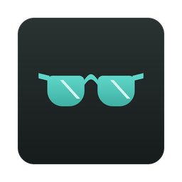
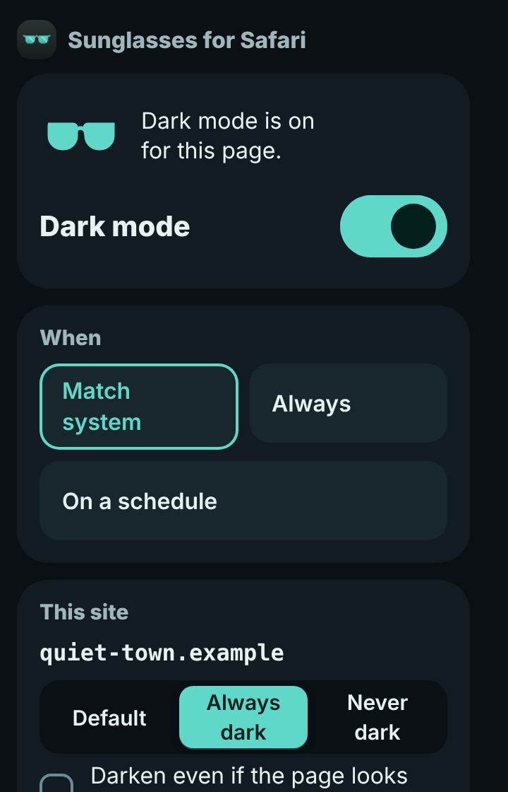
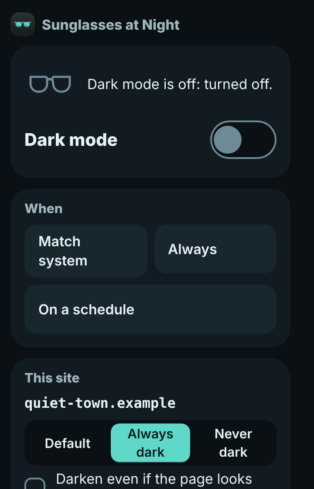
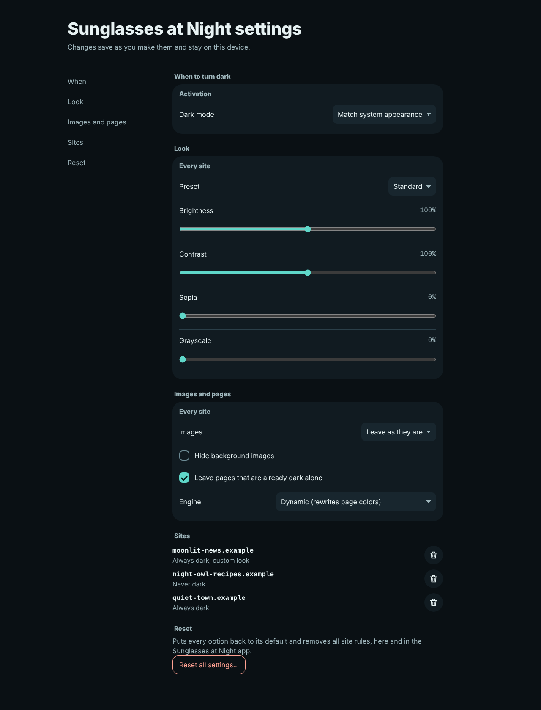

<p align="center">
  
</p>

<h1 align="center">Sunglasses at Night</h1>

<p align="center">A free, private dark mode for every website in Safari on Mac, iPhone and iPad.</p>

You put on sunglasses at night because the web keeps throwing white pages at you. Turn it on once, and pages arrive dark, text stays readable, and nothing ever leaves your device.

## Screenshots

The toolbar popup and the settings page, shown with made-up demo sites.

| Popup, dark mode on | Popup, dark mode off |
| --- | --- |
|  |  |



## What it does

- **When to go dark:** match the system appearance (the default), always, on a schedule (it can cross midnight), or off. On a Mac, Option+Shift+N toggles it.
- **Per site:** default, always dark or never dark, plus an optional per-site look (brightness, contrast, sepia, grayscale) and engine.
- **Two engines:** dynamic rewrites the site's own colors and keeps text at 4.5:1 contrast or better. Filter inverts the page and flips photos back, as a fallback.
- **Images:** leave them, dim them, or don't invert them, with an option to hide background images.
- **Leaves already-dark sites alone,** and avoids the white flash while a page is still loading.
- **Report a problem:** opens a Mail draft to support@rarecreatures.app with the site name, version and settings. You choose whether to send it.

## Install

Sunglasses at Night isn't on the App Store yet, so for now you build it yourself.

You need a Mac with Xcode (macOS 13 or later for the Mac app, iOS or iPadOS 16 or later for iPhone and iPad) and Node.js 22 for the build scripts.

```bash
git clone https://github.com/HarrisonFischberg/sunglasses-at-night.git
cd sunglasses-at-night
node engine/scripts/bundle.js   # builds the extension files from engine/src
```

### Mac

The quickest route is the rebuild script, which needs an "Apple Development" signing certificate in your keychain:

```bash
scripts/build-mac.sh
```

It builds the Mac app, signs it and opens it. Then open Safari, go to Settings, then Extensions, and turn on "Sunglasses at Night". If Safari drops the extension after a restart, turn on "Allow unsigned extensions" in Safari's Develop menu, or sign Xcode into your Apple ID and build with your team.

You can also open `SunglassesAtNight.xcodeproj` in Xcode and run the **Sunglasses at Night (macOS)** scheme.

### iPhone and iPad

Open `SunglassesAtNight.xcodeproj` in Xcode, pick the **Sunglasses at Night (iOS)** scheme, choose your device or a simulator, set your team under Signing and Capabilities, and run. Then go to Settings, Apps, Safari, Extensions and turn on Sunglasses at Night, and allow it on all websites.

## Dark mode

Websites follow your system by default: when your Mac, iPhone or iPad is in dark appearance, pages go dark, and when it's light they stay as the site made them. You can also choose always, a schedule, or off, and set rules for single sites.

The popup and settings page are dark on purpose, even when Safari is light, because the extension exists for dim rooms and a bright popup would defeat the point. The container app follows your system's light or dark appearance like any other Mac or iOS app.

## Privacy

No analytics, no account, no servers and no tracking. Settings stay on your device. The only network request the extension makes is re-reading style files a page has already loaded, so it can darken them. `npm run privacy-check` guards this.

## Development

| Check | Command |
| --- | --- |
| Engine unit tests | `npm test` |
| Privacy check | `npm run privacy-check` |
| Browser tests (WebKit via Playwright) | `npm run e2e` |
| Performance budgets | `npm run perf` |

The browser tests and performance budgets need Playwright's WebKit first: `npm install && npx playwright install webkit`.

- `engine/src` is the source of truth. `node engine/scripts/bundle.js` writes the bundles into `Extension/Resources`, which is what Xcode ships.
- `App/` and `Shared/` hold the SwiftUI container app; `Tests/` holds its Swift tests.
- `prd.md` tracks tasks, `activity.md` is the log, `docs/blueprint.md` explains the architecture and `WRAP-UP.md` has the current state.

The `main` branch holds the launch-readiness plan: `prd.md`, `docs/` (data inventory, compliance checklist, launch blockers) and the build loop tooling in `ralph/` and `replica/`.

## Contact

Made by Rare Creatures LLC. Help or a site that looks wrong: support@rarecreatures.app. Privacy questions: hello@rarecreatures.app. Website: https://rarecreatures.app
